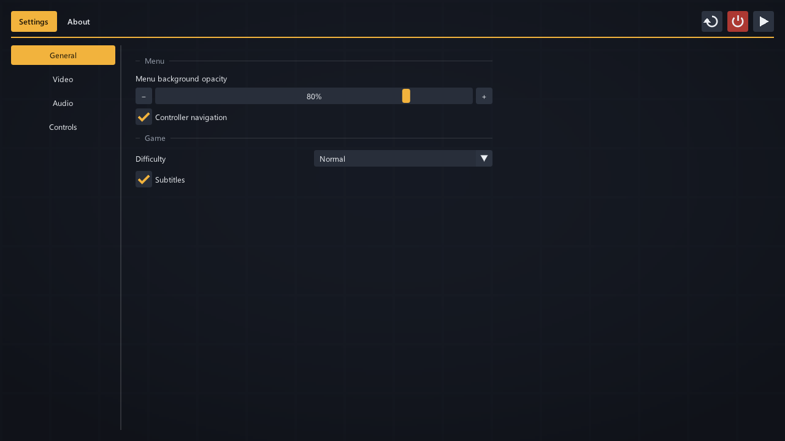
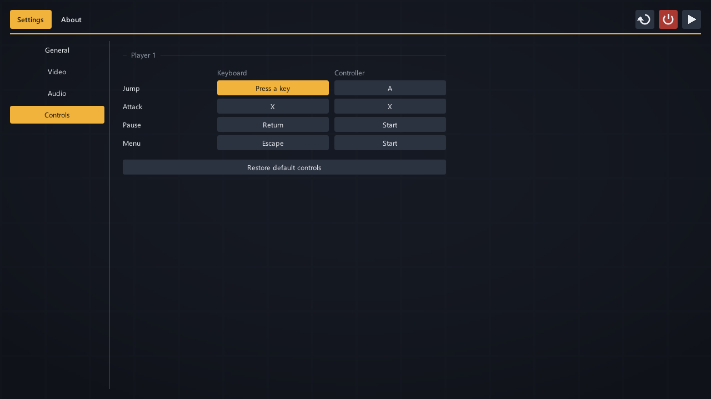
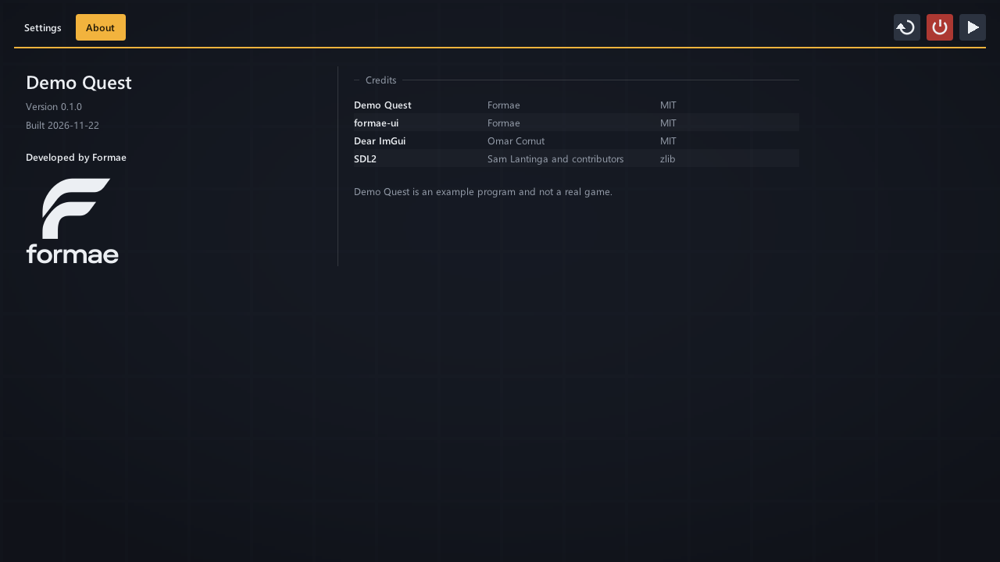
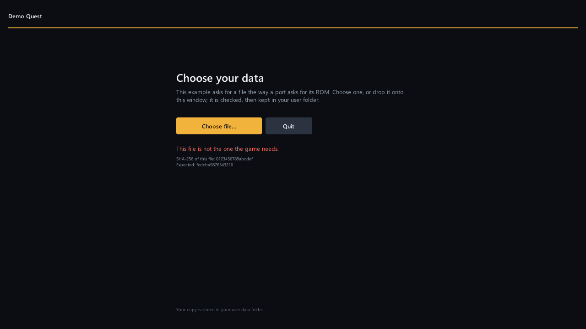

<div align="center">

# formae-ui

A Dear ImGui menu library for PC ports: themed settings menus, input rebinding, About pages and first-run screens.

[](https://gitlab.com/formae/formae-ui/-/pipelines)
[](https://gitlab.com/formae/formae-ui/-/releases)
[](LICENSE)
[](https://en.cppreference.com/w/cpp/17)
[](https://github.com/ocornut/imgui/releases/tag/v1.91.9b)
[](#requirements)

</div>

formae-ui is the menu layer of [Formae](https://gitlab.com/formae)'s game ports, extracted from
[DuckTales Recompiled](https://gitlab.com/formae/ducktales-recompiled) so that every port shares one
look and one set of behaviours. It is a small C++17 static library on top of
[Dear ImGui](https://github.com/ocornut/imgui): the game supplies its pages, settings, texts and
renderer; the library draws the shell, the widgets and the dialogs, scales them to the window and
handles keyboard, mouse and controller navigation.

<div align="center">






</div>

*Screenshots from the off-screen self-test of the bundled example ([examples/demo](examples/demo/main.cpp)).*

## Features

- **Menu shell.** A bar of tabs with icon buttons (reset, quit, resume) on its right, a sidebar of
  categories and the chosen category's page, over the game picture dimmed to a configurable opacity.
- **Widgets.** Titled section separators, toggles, combos, integer and percent sliders with - and +
  buttons that repeat while held, full-width buttons and a "Restart to apply" tag.
- **Input rebinding.** A table of actions by device columns with in-place capture: Escape cancels,
  Delete clears, refusals are shown under the table.
- **Confirmations.** Centred modal questions for destructive actions.
- **About page.** Title, version, build date, developer logo, credits table and disclaimer.
- **First-run screen.** The layout for importing a ROM or game data, with success and error states.
- **Navigation and close rules.** Keyboard, mouse and gamepad; moving onto a tab or category
  chooses it; Escape and B close the menu unless a popup or an active item needs them.
- **Resolution independence.** Every measure derives from one base size computed from the
  drawable height and the display DPI; fonts are rebuilt when it changes.
- **Theming.** One struct of colours; the defaults are the reference look.
- **No platform lock-in.** The library depends on Dear ImGui only. Input arrives as small
  translated events and textures through two callbacks, so any ImGui backend works.

## Requirements

- A C++17 compiler. Tested with Visual Studio 2022 (MSVC v143) on Windows 10 and 11 x64.
- CMake 3.20 or later.
- Dear ImGui 1.91.9b, supplied by your project (see [Installation](#installation)).
- For the example only: SDL2 2.26 or later.

The library code is portable C++ and its fonts fall back to ImGui's own on other systems, but
Windows is the only platform built and tested.

## Installation

formae-ui never builds its own copy of Dear ImGui: it links your project's ImGui target, so a game
has exactly one ImGui and one set of ImGui configuration macros.

### As a submodule (recommended)

```powershell
git submodule add https://gitlab.com/formae/formae-ui.git external/formae-ui
git -C external/formae-ui checkout v0.1.0
```

```cmake
add_library(imgui STATIC
    external/imgui/imgui.cpp external/imgui/imgui_draw.cpp
    external/imgui/imgui_tables.cpp external/imgui/imgui_widgets.cpp)
target_include_directories(imgui PUBLIC external/imgui external/imgui/backends)

add_subdirectory(external/formae-ui)
target_link_libraries(my_game PRIVATE imgui formae::ui)
```

Name a target other than `imgui` with `-DFORMAE_UI_IMGUI_TARGET=<target>`. If ImGui is compiled
directly into your executable, set `FORMAE_UI_IMGUI_DIR` to its headers (and
`FORMAE_UI_IMGUI_DEFINITIONS` to its configuration macros) instead.

### From an installed package

```powershell
cmake -S formae-ui -B build -G "Visual Studio 17 2022" -A x64 -DFORMAE_UI_BUILD_EXAMPLES=OFF -DFORMAE_UI_INSTALL=ON
cmake --build build --config Release
cmake --install build --config Release --prefix C:/sdk/formae-ui
```

```cmake
add_library(imgui STATIC ...)          # define your ImGui target first
find_package(formae-ui 0.1 CONFIG REQUIRED)
target_link_libraries(my_game PRIVATE formae::ui)
```

An installed library must be used with the same ImGui version and configuration it was built with.

## Usage

A two-page settings menu on SDL2 and ImGui's SDL_Renderer backend. This is
[examples/minimal/minimal.cpp](examples/minimal/minimal.cpp), which the build compiles:

```cpp
#include "formae/ui.h"
#include "imgui_impl_sdl2.h"
#include "imgui_impl_sdlrenderer2.h"
#include <SDL.h>

namespace ui = formae::ui;

static int volume = 80;
static bool vsync = true;

int main()
{
    SDL_Init(SDL_INIT_VIDEO | SDL_INIT_GAMECONTROLLER);
    SDL_Window *window = SDL_CreateWindow("My Port", SDL_WINDOWPOS_CENTERED, SDL_WINDOWPOS_CENTERED, 1280, 720,
                                          SDL_WINDOW_ALLOW_HIGHDPI);
    SDL_Renderer *renderer = SDL_CreateRenderer(window, -1, SDL_RENDERER_PRESENTVSYNC);
    {
        ui::Context context;
        ImGui_ImplSDL2_InitForSDLRenderer(window, renderer);
        ImGui_ImplSDLRenderer2_Init(renderer);

        ui::Menu menu({ { "Settings",
                          { { "Audio", [] { ui::section("Volume"); ui::slider_percent("Master volume", &volume, 0, 100, 5); } },
                            { "Video", [] { ui::section("Display"); ui::toggle("VSync", &vsync); } } } } },
                      { { "##resume", ui::Icon::resume } });

        bool open = true;
        while (open) {
            SDL_Event event;
            while (SDL_PollEvent(&event)) {
                ui::InputEvent input;
                if (event.type == SDL_KEYDOWN) {
                    input.type = ui::InputEvent::key_down;
                    input.cancel = event.key.keysym.scancode == SDL_SCANCODE_ESCAPE;
                }
                if (event.type == SDL_QUIT || menu.event(input) == ui::EventResult::close) open = false;
                else ImGui_ImplSDL2_ProcessEvent(&event);
            }
            int width = 0, height = 0;
            SDL_GetRendererOutputSize(renderer, &width, &height);
            if (context.fit(ui::base_size(height, 96.0f))) ImGui_ImplSDLRenderer2_DestroyFontsTexture();

            ImGui_ImplSDLRenderer2_NewFrame();
            ImGui_ImplSDL2_NewFrame();
            ImGui::NewFrame();
            if (menu.draw(80) == 0) open = false;
            ImGui::Render();
            SDL_RenderClear(renderer);
            ImGui_ImplSDLRenderer2_RenderDrawData(ImGui::GetDrawData(), renderer);
            SDL_RenderPresent(renderer);
        }
        ImGui_ImplSDLRenderer2_Shutdown();
        ImGui_ImplSDL2_Shutdown();
    }
    SDL_DestroyRenderer(renderer);
    SDL_DestroyWindow(window);
    SDL_Quit();
}
```

A full integration, with bindings, the About page, the first-run screen and a game picture behind
the menu, is in [examples/demo/main.cpp](examples/demo/main.cpp) and
[docs/integration.md](docs/integration.md).

## Theming

Every colour is a field of `formae::ui::Theme`, passed to the `Context`:

```cpp
formae::ui::Theme theme;
theme.accent = IM_COL32(88, 166, 255, 255);
theme.accent_hi = IM_COL32(128, 188, 255, 255);
theme.on_accent = IM_COL32(8, 20, 36, 255);
formae::ui::Context context(theme);
```

Sizes follow the base size (`formae::ui::base_size`), and fonts default to the system UI font
(Segoe UI on Windows). See [docs/theming.md](docs/theming.md).

## API overview

Everything is in `formae/ui.h`, namespace `formae::ui`; the version is in `formae/version.h`.

| Component | Purpose |
|---|---|
| `Context`, `Theme`, `FontFiles`, `base_size` | ImGui context, colours, fonts and scale |
| `Menu`, `Tab`, `Category`, `BarButton` | The menu shell, its pages and the bar's buttons |
| `InputEvent`, `EventResult`, `Menu::event` | Close rules and binding capture, fed by the game's events |
| `section`, `tag`, `toggle`, `combo`, `slider`, `slider_percent`, `button` | Page widgets |
| `pick_button`, `icon_button`, `confirm` | Building blocks of the shell, usable on their own |
| `BindingTable`, `binding_table` | Input rebinding table with capture |
| `About`, `Credit`, `Logo`, `TextureCallbacks`, `about_page` | About page and developer logo |
| `FirstRunScreen`, `FirstRunContent` | First-run (ROM or data import) screen |
| `formae_ui_embed_file` (CMake) | Embeds a binary file, such as a logo, as a byte array |

| Guide | Contents |
|---|---|
| [Getting started](docs/getting-started.md) | Adding the library, the frame loop, the first menu |
| [Widgets](docs/widgets.md) | Every public component with a snippet |
| [Theming](docs/theming.md) | Colours, fonts and sizes |
| [Integration](docs/integration.md) | Wiring settings, textures and input in a game |

## Example and self-test

`examples/demo` is a complete integration for a made-up game on SDL2. Its `--selftest <dir>` mode
draws every page off screen in a hidden window and writes a PNG of each, so the library can be
checked without opening a visible window; `tests/smoke.cpp` exercises every component headless.

```powershell
git clone --recurse-submodules https://gitlab.com/formae/formae-ui.git
cd formae-ui
cmake -S . -B build -G "Visual Studio 17 2022" -A x64 -DSDL2_DIR=C:/path/to/SDL2/cmake
cmake --build build --config Release --parallel
ctest --test-dir build -C Release --output-on-failure
```

The PNGs are written to `build/examples/selftest/`.

## Versioning

formae-ui follows [Semantic Versioning](https://semver.org/). While the major version is 0, a minor
release may change the API; patch releases never do. Releases are tagged `vMAJOR.MINOR.PATCH` and
described in [CHANGELOG.md](CHANGELOG.md). `FORMAE_UI_VERSION_MAJOR`, `_MINOR` and `_PATCH` in
`formae/version.h` give the version at compile time.

## Contributing

Issues and merge requests are welcome. Read [CONTRIBUTING.md](CONTRIBUTING.md) for the setup, the
checks and the style, and follow the [code of conduct](CODE_OF_CONDUCT.md). Report security issues
as described in [SECURITY.md](SECURITY.md).

## License

formae-ui is released under the [MIT license](LICENSE), copyright Formae. It bundles
[stb_image](https://github.com/nothings/stb) (public domain) to decode logos. Dear ImGui (MIT) and
SDL2 (zlib), used by the example, are under their own licenses.
