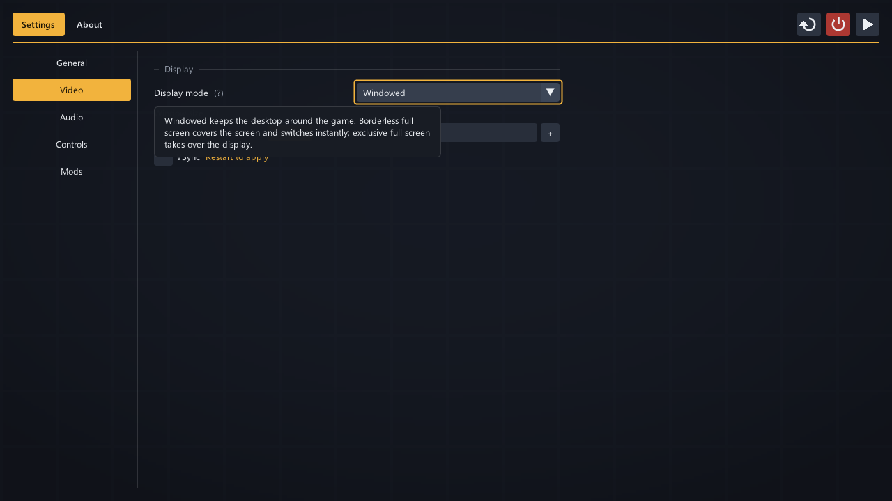
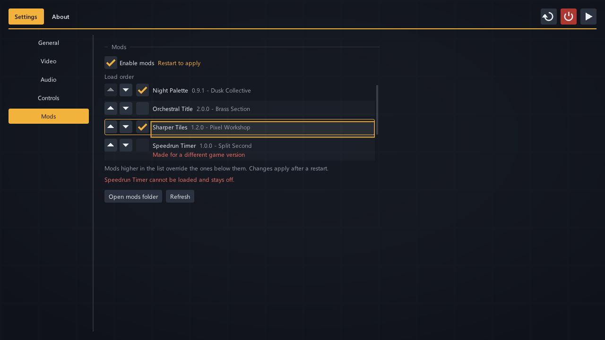

# Widgets and components

Everything below is declared in `formae/ui.h`, namespace `formae::ui` (shortened to `ui::`).
Widgets draw with the current `Context`'s theme and fonts, inside a page callback of a `Menu`
(or any ImGui window). All of them use plain ImGui underneath, so ImGui calls can be mixed in.

## Page widgets

### section

A dimmed title with a rule after it. Start each group of settings with one.

```cpp
ui::section("Display");
```

### Help markers

`toggle`, `combo`, `slider` and `slider_percent` take an optional last argument, `help`: what the
setting does, in a sentence or two. The widget then draws a dimmed "(?)" after its label and shows
the text in a tooltip, wrapped to 24 base sizes, while the mouse is over the marker or the control
(disabled controls included) or while keyboard or gamepad navigation is on the control; under
navigation the tooltip opens just below the row. A null `help` draws exactly what the widget drew
before, so existing pages keep their pixels.



```cpp
ui::toggle("Integer scaling", &settings.integer_scale, "Scale the picture by whole numbers only.");
ui::combo("Pixels", &settings.pixels, PIXELS, 3, nullptr, "How pixels are drawn when the picture is scaled.");
ui::slider_percent("Master volume", &settings.volume, 0, 100, 5, nullptr, "The volume of everything the game plays.");
```

### toggle

A checkbox. Returns true when it changed.

```cpp
if (ui::toggle("Integer scaling", &settings.integer_scale)) save();
```

### combo

A label on the left and a drop-down on the right half. `note` adds a tag after the label.

```cpp
static const char *const MODES[] = { "Windowed", "Borderless full screen", "Exclusive full screen" };
ui::combo("Display mode", &settings.mode, MODES, 3);
ui::combo("Frame pacing", &settings.pacing, PACING, 3, pacing_changed ? ui::restart_to_apply : nullptr);
```

### slider and slider_percent

A label above a slider with - and + buttons that repeat while held, clamped to the range. The
format is the slider's printf format; the minus and multiplication signs fall back to ASCII when
the font lacks them.

```cpp
ui::slider("Window size", &settings.scale, 1, 8, 1, "%d\xC3\x97");
ui::slider_percent("Master volume", &settings.volume, 0, 100, 5);
ui::slider("Extra lives", &lives, 0, 9, 1, lives == 0 ? "Off" : "%d");
```

### button

A full-width button.

```cpp
ImGui::BeginDisabled(!changed);
if (ui::button("Restore defaults")) restore_defaults();
ImGui::EndDisabled();
```

### tag and restart_to_apply

Accent text on the line of the previous item; nothing when the text is null.

```cpp
ui::toggle("VSync", &settings.vsync);
ui::tag(settings.vsync != vsync_at_start ? ui::restart_to_apply : nullptr);
```

### note

A paragraph wrapped to the page width, dimmed by default, or in the ok or error colour of the
theme for `Status::ok` and `Status::error`.

```cpp
ui::note("Mods higher in the list override the ones below them. Changes apply after a restart.");
ui::note(error.c_str(), ui::Status::error);
```

### inline_button

A button as wide as its label (`button` is full width), so several can share a line.

```cpp
if (ui::inline_button("Open mods folder")) open_mods_folder();
ImGui::SameLine();
if (ui::inline_button("Refresh")) rescan_mods();
```

## Reorderable list

### reorder_list, ListRow, ListEdit, ListOptions



A list in priority order, such as mods or texture packs, whose rows the player moves and switches
on or off. Each row has an up and a down button, an enable checkbox, the name, dimmed details after
it and, when `error` is set, a second line in the error colour; such a row's checkbox is disabled
and drawn off, but the row can still be moved. Moves and toggles are applied to `rows` in place,
and the return value says which one happened in this frame (at most one), so the game can save.

```cpp
std::vector<ui::ListRow> mods = load_mod_list();   // { id, name, detail, error, enabled }

ui::toggle("Enable mods", &settings.mods);
ui::ListOptions options;
options.visible_rows = 6.0f;
options.header = "Load order";
options.empty = "No mods installed.";
const ui::ListEdit edit = ui::reorder_list("##mods", mods, options);
if (edit.kind != ui::ListEdit::none) save_mod_list(mods);   // ids in order, with their enabled flag
ui::note("Mods higher in the list override the ones below them. Changes apply after a restart.");
```

| Input | Effect |
|---|---|
| Up or down button (click, A, Enter or Space) | Moves the row one place; the focus stays on the button, so pressing again keeps moving the same row |
| Ctrl or Alt with Up or Down | Moves the row holding the keyboard focus, which stays on it |
| A, Enter or Space on the name | Picks the row up (accent outline): Up and Down (arrows, D-pad, left stick) move it, A, Enter, Space, B or Escape put it down |
| Dragging the name with the mouse (`drag`) | Moves the row one place at a time to where the pointer is |
| Checkbox | Switches the row; returns `ListEdit::toggled` |

`ListEdit` is `moved` with `row` (the index before the move) and `to` (after it), `toggled`
with `row`, or `none`. ImGui ids come from `ListRow::id`, so the focus, a pick-up and the
scroll position follow a row when it moves; keep ids unique and stable. A picked-up row is ImGui's
active item, so `Menu::busy()` is true and `Menu::event` gives Escape and B to ImGui, which puts
the row down without closing the menu.

| `ListOptions` | Default | Meaning |
|---|---|---|
| `visible_rows` | 0 | Height of a scrolling region, in one-line rows; 0 draws every row with no scrolling |
| `checkboxes` | true | Draw the enable checkbox |
| `drag` | true | Let the mouse drag rows |
| `empty` | null | Dimmed text shown when there are no rows |
| `header` | null | Dimmed caption above the rows |

The scrolling region is a navigation-flattened child: keyboard and gamepad navigation move between
the page and the rows like any other page items, and a moved row is scrolled into view.

## Menu

### Menu, Tab, Category, BarButton

The shell: the bar of tabs, the square buttons at its right, the sidebar of the chosen tab's
categories and the chosen category's page, over a backdrop. A tab without categories draws one wide
page with its own `draw`.

```cpp
ui::Menu menu(
    { { "Settings", { { "General", page_general }, { "Video", page_video }, { "Controls", page_controls } } },
      { "About", {}, [&] { ui::about_page(about); } } },
    { { "##reset", ui::Icon::reset, false, "Reset the game?", "Reset" },
      { "##quit", ui::Icon::quit, true, "Quit the game?", "Quit" },
      { "##resume", ui::Icon::resume } });

int pressed = menu.draw(opacity_percent);
```

`draw` returns the index of the bar button pressed (after its confirmation when it has a
`question`), or -1. `select(tab, category)`, `ask(button)` and `focus_page()` drive the menu from
code, which is how a self-test visits every page.

### Menu::event, InputEvent, EventResult

The close rules and the binding capture. Give every event to `event` before ImGui:

| Result | Meaning |
|---|---|
| `pass` | Give the event to ImGui |
| `swallow` | The menu used it (a capture); drop it |
| `close` | Close the menu |

The menu shortcut (`InputEvent::menu`) always closes. Escape (`cancel`) and B (`back`) close
unless a popup is open or an item is active, in which case ImGui gets them (a combo closes, a
confirmation cancels).

### confirm

The centred question the bar buttons use, available on its own. It opens when `*ask` is set:

```cpp
static bool ask = false;
if (ui::button("Delete save")) ask = true;
if (ui::confirm("##delete", &ask, "Delete this save?", "Delete")) delete_save();
```

### pick_button and icon_button

The tab and category button (accent while chosen, chosen by navigation) and the square icon button.

```cpp
if (ui::pick_button("Video", page == 1, ImVec2(width, height))) page = 1;
if (ui::icon_button("##resume", ui::Icon::resume, size)) resume();
```

## Input binding

### BindingTable and binding_table

Rows of actions by device columns. Names, texts and the meaning of a binding are the game's;
pressing a cell starts a capture, and `Menu::event` delivers the next key, button or axis to
`assign`. Escape (or B in a keyboard column) cancels, Delete or Backspace clears (`assign` gets a
null event), a click cancels. A string returned by `assign` is shown under the table for four
seconds.

```cpp
ui::BindingTable table;
table.columns = { { "Keyboard", ui::Device::keyboard, "Press a key" },
                  { "Controller", ui::Device::gamepad, "Press a button" } };
table.rows = ACTION_COUNT;
table.label = [](int row) { return ACTION_NAMES[row]; };
table.text = [](int row, int column, char *out, size_t cap) { return describe_binding(row, column, out, cap); };
table.assign = [](int row, int column, const ui::InputEvent *e) { return bind(row, column, e); };
table.restore_label = "Restore default controls";
table.restore = restore_default_bindings;

ui::section("Player 1");
ui::binding_table(menu, table);
```

`text` returns false for an unbound cell, which is drawn dimmed. Keep the table alive for as long
as the menu, since a capture refers to it.

## About page

### About, Credit, Logo, TextureCallbacks, about_page

```cpp
ui::Logo logo(formae_logo_png, formae_logo_png_size, { renderer, create_texture, destroy_texture });

ui::About about;
about.title = "My Port";
about.version = MY_PORT_VERSION;
about.build_date = MY_PORT_BUILD_DATE;
about.developer = "Developed by Formae";
about.logo = &logo;
about.credits = { { "My Port", "Formae", "MIT" }, { "Dear ImGui", "Omar Cornut", "MIT" } };
about.disclaimer = "My Port is not affiliated with the original publisher.";

ui::about_page(about);
```

The logo is a PNG (embed it with `formae_ui_embed_file`) whose coverage is drawn in its own colour
at 6.5 base sizes high, area-averaged from the original. `TextureCallbacks::create` receives
straight-alpha `0xAARRGGBB` pixels and returns a linearly filtered, alpha-blended texture of your
renderer; call `logo.release()` before the renderer goes away.

## First-run screen

### FirstRunScreen, FirstRunContent, FirstRunAction, Status

```cpp
ui::FirstRunScreen screen;
ui::FirstRunContent content;
content.app_title = "My Port";
content.title = "Choose your ROM";
content.text = "This port runs on your own copy of the game.";
content.primary = "Choose ROM file\xE2\x80\xA6";
content.secondary = "Quit";
content.status = error.empty() ? ui::Status::none : ui::Status::error;
content.status_text = error.c_str();
content.footer = "Your copy is stored in your user folder.";

switch (screen.draw(content)) {
case ui::FirstRunAction::primary: open_file_dialog(); break;
case ui::FirstRunAction::secondary: quit(); break;
default: break;
}
```

Escape and B count as the secondary action; `busy` disables both buttons while the game works.

## Context and helpers

| Declaration | Purpose |
|---|---|
| `Context(theme, files)` | Creates the ImGui context and makes itself current |
| `Context::fit(base)` | Rebuilds fonts and style for a base size; true when the font texture must be recreated |
| `Context::make_current()` | Makes it and its ImGui context current |
| `Context::set_gamepad_navigation(on)` | A "controller navigation" setting |
| `Context::fonts()`, `theme()`, `imgui()` | The fonts, theme and ImGui context |
| `current()` | The current context |
| `base_size(height, dpi)` | The base size for a drawable |
| `system_font_files()` | The platform's UI font files |
| `glyphs(text)` | Text with symbols replaced by ASCII when the fonts lack them |
| `formae/version.h` | `FORMAE_UI_VERSION_MAJOR`, `_MINOR`, `_PATCH`, `FORMAE_UI_VERSION` |

## CMake

### formae_ui_embed_file

```cmake
formae_ui_embed_file(my_game formae_logo_png "${CMAKE_SOURCE_DIR}/assets/formae.png")
```

Writes `formae_logo_png.c` and `formae_logo_png.h` in the build tree, adds them to the target and
declares, with C linkage, `const unsigned char formae_logo_png[]` and `const size_t
formae_logo_png_size`. CMake configures again when the file changes.
